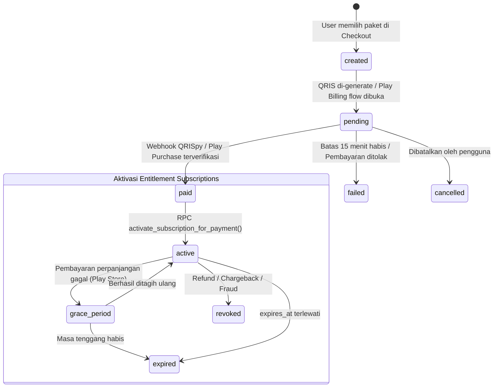

# 💳 Panduan Sistem Pembayaran & Aktivasi Langganan Pro (PAYMENTS.md)

Dokumen ini adalah referensi teknis arsitektur pembayaran terpadu (*Dual-Track Payment System*), verifikasi sisi server (*Server-Authoritative Activation*), siklus webhook, idempotensi, dan kebijakan Google Play untuk **Mari Partner Fuel**.

---

## 🏛️ 1. Prinsip & Regulasi Distribusi (Dual-Track Architecture)

Untuk mematuhi **Google Play Payments Policy** sekaligus menyediakan fleksibilitas distribusi direct/sideload/web, Mari Partner Fuel menerapkan arsitektur dua jalur:

```text
┌─────────────────────────────────────────────────────────────────────────────────┐
│                    MARI PARTNER FUEL — DUAL-TRACK PAYMENTS                      │
├────────────────────────────────────────┬────────────────────────────────────────┤
│          Jalur 1: Google Play Store    │    Jalur 2: Direct / Web / Sideload    │
│            (Distribusi Resmi)          │         (Non-Play Distribution)        │
├────────────────────────────────────────┼────────────────────────────────────────┤
│ • Provider: Google Play Billing v7.1.1 │ • Provider: QRISpy (Default) / Midtrans│
│ • Kontrak: Auto-renewing In-App Sub    │ • Kontrak: Dynamic QRIS (15 menit)     │
│ • Token verifikasi via Play API backend│ • Webhook signature HMAC-SHA256        │
│ • Lifecycle via RTDN Cloud Pub/Sub     │ • Polling status fallback klien        │
└────────────────────────────────────────┴────────────────────────────────────────┘
```

> [!IMPORTANT]
> **Kepatuhan Kebijakan Google Play:**
> Aplikasi yang didistribusikan melalui Google Play Store **WAJIB** menggunakan Google Play Billing untuk pembelian fitur digital (termasuk status Pro dan kuota AI). Klien Android mendeteksi build flavor/distribution channel dan mengarahkan pengguna ke Google Play Billing secara default. QRISpy / Midtrans hanya diaktifkan jika aplikasi didistribusikan di luar ekosistem Google Play (misalnya web direct download / enterprise distribution).

---

## 🔒 2. Backend-Authoritative Entitlement (Anti-Tamper & Anti-Replay)

1. **Server-Authoritative Pricing:**
   - Klien Android **TIDAK PERNAH** mengirimkan harga transaksi. Harga dibaca secara otoritatif dari tabel `subscription_plans` di backend Supabase.
2. **Anti-Replay Purchase Token:**
   - Setiap `purchase_token` dari Google Play Billing dicatat dan dicek keunikannya di kolom `payment_transactions(provider, provider_payment_id)`.
   - Jika token yang sama diajukan ulang oleh user berbeda (atau user yang sama tanpa event perpanjangan resmi), Edge Function `verify-play-purchase` menolak permintaan dengan HTTP 403 `PURCHASE_TOKEN_ALREADY_USED`.
3. **Pemisahan Entitas:**
   - `payment_transactions`: Menyimpan riwayat invoice finansial, status pembayaran, token gateway, dan payload mentah.
   - `subscriptions`: Menyimpan hak akses pengguna saat ini (*entitlement*), kuota AI, batas kendaraan, tanggal aktif (`starts_at`), dan tanggal kedaluwarsa (`expires_at`).
4. **Perpanjangan Atomik (Atomic Plan Extension):**
   - Jika pengguna membeli paket Pro saat status Pro masih aktif, durasi paket baru ditambahkan langsung ke `expires_at` yang sudah ada (bukan di-reset dari `now()`), menjaga hak hari langganan yang tersisa.

---

## 🔄 3. State Machine Transaksi & Langganan



### Definisi Status `payment_transactions`:
- `created`: Pesanan dibuat di backend dengan nominal terverifikasi.
- `pending`: Menunggu transfer e-wallet/bank (QRIS) atau otorisasi kartu (Play Store).
- `paid`: Dana berhasil diterima dan diverifikasi server.
- `failed`: Transaksi gagal atau ditolak provider.
- `expired`: Waktu pembayaran melebihi batas toleransi (15 menit untuk QRIS).
- `cancelled`: Dibatalkan sebelum pembayaran selesai.
- `refunded`: Dana dikembalikan ke pembeli.

---

## ⚡ 4. Arsitektur Supabase Edge Functions

| Nama Function | Akses / Auth | Fungsi Utama |
|---|---|---|
| `create-checkout` | User JWT | Membuat order transaksi `payment_transactions` berstatus `created` dengan harga server. Jika QRISpy, memanggil API gateway untuk string QRIS dinamis. |
| `verify-play-purchase` | User JWT | Memvalidasi `purchase_token` dan `product_id` ke Google Play Developer API (atau sandbox verifier), mencegah replay attack, dan mengaktifkan Pro via RPC. |
| `get-payment-status` | User JWT | Mengambil status riil transaksi dan langganan untuk polling layar status Android. |
| `payment-webhook` | Public (Secret Signed) | Menerima callback server-to-server dari QRISpy/Midtrans, memvalidasi signature HMAC/token, mengunci idempotensi, dan mengaktifkan Pro. |
| `sync-subscription` | User JWT | Memaksa rekonsiliasi status langganan dan sisa kuota AI dari server ke klien. |

---

## 🛡️ 5. Prosedur Idempotensi Webhook

Untuk mencegah perpanjangan ganda akibat webhook retry dari gateway pembayaran:

1. Webhook masuk ke Edge Function `payment-webhook`.
2. Signature payload diverifikasi menggunakan `QRISPY_WEBHOOK_SECRET` atau `MIDTRANS_SERVER_KEY`.
3. Dipanggil fungsi basis data atomik:
   ```sql
   select record_payment_webhook_event(
       p_provider := 'qrispy',
       p_event_id := webhook_event_id,
       p_event_type := 'payment.success',
       p_payload := event_json
   );
   ```
4. Jika `record_payment_webhook_event` mengembalikan `is_duplicate = true`, Edge Function segera merespons `HTTP 200 OK` tanpa menjalankan mutasi `subscriptions` kedua kalinya.
5. Jika belum pernah diproses, RPC `activate_subscription_for_payment` dieksekusi secara atomik dalam satu transaksi PostgreSQL.

---

## ☁️ 6. Integrasi Real-Time Developer Notifications (RTDN) Google Play

Untuk memproses auto-renewal, pembatalan, refund, dan grace period dari Google Play Store secara real-time:

```text
[Google Play Store] ────(Pub/Sub Event)────► [Google Cloud Pub/Sub Topic]
                                                       │
                                                       ▼
[Supabase Edge Function: play-rtdn-webhook] ◄───(Push Subscription)
                      │
                      ▼
[PostgreSQL RPC: handle_subscription_lifecycle_event]
```

### Konfigurasi Cloud Pub/Sub:
1. Buat Topic di Google Cloud Console: `projects/<project-id>/topics/play-billing-notifications`.
2. Berikan role *Pub/Sub Publisher* ke akun layanan Google Play: `google-play-developer-notifications@system.gserviceaccount.com`.
3. Buat Push Subscription yang mengarah ke endpoint webhook Edge Function: `https://<supabase-project-id>.supabase.co/functions/v1/play-rtdn-webhook`.
4. Masukkan nama topic pada Google Play Console di menu **Monetization setup > Real-time developer notifications**.

---

## 🔑 7. Variabel Lingkungan & Secret Backend

Semua secret di bawah ini tersimpan secara aman di **Supabase Secrets Vault** dan **TIDAK PERNAH** dimasukkan ke dalam kode Android atau file Git:

| Variabel Secret | Tujuan / Provider | Lokasi Simpan |
|---|---|---|
| `SUPABASE_SERVICE_ROLE_KEY` | Akses bypass RLS untuk aktivasi langganan backend | Supabase Edge Function Secrets |
| `GOOGLE_PLAY_SERVICE_ACCOUNT_JSON` | Kredensial OAuth2 Google API untuk validasi pembelian Play Store | Supabase Edge Function Secrets |
| `GOOGLE_PLAY_PACKAGE_NAME` | Package name Android (`id.maripartner.fuel`) | Supabase Edge Function Secrets |
| `QRISPY_API_KEY` | Kunci autentikasi API QRISpy Gateway | Supabase Edge Function Secrets |
| `QRISPY_WEBHOOK_SECRET` | Secret token validasi webhook masuk dari QRISpy | Supabase Edge Function Secrets |
| `MIDTRANS_SERVER_KEY` | Server key untuk adapter sekunder Midtrans | Supabase Edge Function Secrets |

---

## 🧪 8. Panduan Pengujian Sandbox & Development

### A. Pengujian Google Play Billing (License Testing)
1. Daftarkan akun Gmail tester pada **Google Play Console > License Testing**.
2. Pasang kartu uji coba Google Play:
   - *Test card, always approves*
   - *Test card, always declines*
   - *Slow test card (takes a few minutes to approve)*
3. Uji alur perpanjangan langganan dengan opsi durasi dipercepat (misal: 1 bulan menjadi 5 menit).

### B. Pengujian QRISpy Sandbox
1. Gunakan mode development: Klien mengirimkan request checkout dengan mock provider atau QRIS simulator.
2. Simulasikan webhook pembayaran sukses:
   ```bash
   curl -X POST https://<project>.supabase.co/functions/v1/payment-webhook \
     -H "Content-Type: application/json" \
     -H "X-QRISpy-Signature: <computed-hmac>" \
     -d '{
       "event_id": "evt_test_12345",
       "provider_payment_id": "qris_999888777",
       "payment_reference": "MPF-20261029-XXXX",
       "amount_idr": 29000,
       "status": "paid"
     }'
   ```
3. Periksa status pada aplikasi Android: layar secara otomatis beralih ke `PaymentStatusScreen` menampilkan tanda centang sukses dan lencana "PRO AKTIF".

---

## 📋 9. Daftar Item Konfigurasi Manual yang Tersisa (Blocker External)

Agar pembayaran production dapat menerima uang riil:
1. **Google Play Console:**
   - Mengunggah APK/AAB pertama ke jalur Internal Testing untuk mengaktifkan Play Billing API.
   - Membuat produk langganan in-app: `pro_monthly` (Rp 29.000/bln) dan `pro_yearly` (Rp 290.000/thn).
   - Menghubungkan Google Payments Merchant Account untuk pencairan dana.
2. **Google Cloud Console:**
   - Mengaktifkan Google Play Android Developer API.
   - Membuat Service Account dengan akses *View Financial Data* dan mengunduh JSON key.
3. **Akun Merchant QRISpy / Midtrans:**
   - Mendaftarkan akun bisnis dan menyelesaikan KYC perbankan untuk aktivasi QRIS statis/dinamis.
   - Menyetel URL webhook ke `https://<supabase-id>.supabase.co/functions/v1/payment-webhook`.
